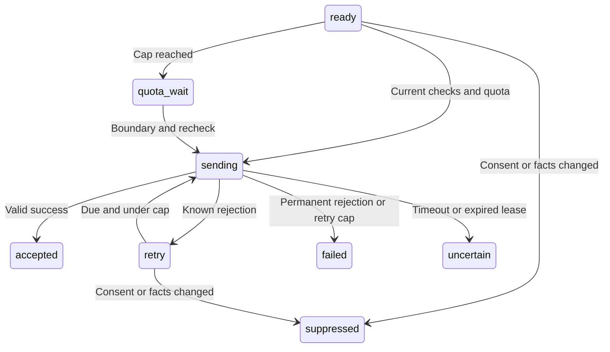

# Outbound delivery adapters and simulation worker

Checkpoint: 31 October 2026. Simulation only. No native network transport, real provider credentials, bot or sending domain is wired into this path.

## Test preparation

The owner can prepare the latest accepted local digest at `/notifications` or `POST /api/me/delivery-tests`. Preparation requires current enabled local consent, matching preference version and an entirely synthetic payload. Email recipients must use `.test`; Telegram requires a confirmed local binding. One simulation job is created per digest. Owner history shows only status, channel, attempt count and safe error codes.

Provider requests use fixed fake credentials and the `.test` application origin. The complete request and destination are encrypted at rest with AES-256-GCM using a dedicated local key and owner-authenticated data. The request body and email idempotency key are frozen; known retries cannot silently alter either.

The email request builder includes plain text, escaped HTML, funding/fee uncertainty and signed local unsubscribe paths/headers. These headers are test fixtures, not qualified production RFC 8058 mail. The Telegram builder uses plain text, disables previews and paid broadcasting, and rejects oversized messages instead of silently dropping items.

## State and limits



The worker claims one due job, reloads consent/channel/version, checks email suppression or current Telegram binding version, and re-evaluates matches, dismissals, material facts, publication, deadlines and 24-hour verification freshness. It coordinates user/profile/opportunity records during the claim transaction. If any frozen item becomes invalid, the whole simulation is suppressed; the worker does not mutate the request or change its idempotency identity.

Daily and monthly simulation quotas use UTC periods. Reservations for both periods commit atomically before each attempt; a monthly failure rolls back the daily increment. Every attempt conservatively consumes capacity, even a rejected or uncertain call. Caps are explicit worker inputs, not claims about provider free tiers. Quota waits move to the next UTC period boundary and recheck state before attempting.

A one-minute attempt lease and unique token prevent another worker from claiming an active job. Expired sending leases become uncertain, not queued. Late fenced completions do not overwrite that uncertainty. No automatic uncertain-result resend exists, including for email after a provider idempotency window could expire.

The injected adapter has a 15-second abort deadline. Known 429 responses honor supported Retry-After seconds/HTTP dates or Telegram retry_after, with a minimum one-minute retry. Delays over one day require review. Resend concurrent-idempotent-request conflicts can retry; body/idempotency conflicts cannot. The worker allows at most three attempts. Retries stop as uncertain after 23 hours from the first attempt, conservatively inside the email provider's documented 24-hour key window. Unattempted snapshots older than 24 hours are suppressed. Network errors, 5xx and malformed success responses are uncertain; permanent 4xx fail. Telegram forbidden outcomes revoke only the captured binding version, preserving any newer connection.

No database transaction stays open during the injected transport call. Consent/source changes after handoff cannot recall an already-started request; real-provider cancellation and uncertain-acceptance qualification remain pending. A success means only that the fixture/provider response was accepted, never inbox delivery or reading.

Accepted email IDs persist before callback mapping is registered. If registration fails, mapping_pending remains true. A later worker repairs that metadata idempotently without re-sending; early callbacks can then reconcile. If ownership/key conditions prevent repair, the pending state remains for review.

## Running a local fixture

`npm run setup:local` adds SMARTMANU_DELIVERY_MODE=local and a dedicated random DELIVERY_SIMULATION_KEY without printing it. Restart the server, create/accept a synthetic local digest, and prepare it through the owner page. Stop the embedded database's server before invoking another process:

```sh
npm run delivery:test:once
```

The command uses an in-memory fixture transport that never calls fetch or opens a socket. It processes one simulation with example caps of 25 daily and 100 monthly attempts. Those numbers are test settings, not an approved provider budget. Re-running does not re-send accepted or uncertain jobs.

This queue is separate from production event delivery. Its source digest was already accepted by the local sink; copying it for a test does not establish production event-seen/overflow correctness across real transports. Live delivery must use a qualified production intent pipeline and fresh live consent rather than promoting simulation rows.

## Validation and remaining work

PGlite and PostgreSQL tests cover request escaping/size and paid-broadcast settings, response classification, immutable retries, atomic quota rollback, retry limits, lease expiry across database restart, stale completion fencing, opt-out suppression, accepted-result deduplication, metadata repair without a provider call, and Telegram binding revocation. HTTP checks cover owner access and preparation validation. Existing build, domain and offline-agent checks remain required. Browser visual/accessibility validation is pending.

The transport interface is intentionally injected, with no default live fetch implementation or credential lookup. Production HTTPS/redirect/response-size handling, verified sending domain and bot, provider quota accounting, live delivery/webhook correlation, reconciliation/support controls, scheduling/monitoring, secret rotation, retention/deletion and public release remain pending. Simulation encryption keys must be retained or migrated; no key rotation workflow is provided.

## Official references checked on 31 October 2026

- [Resend idempotency keys](https://resend.com/changelog/idempotency-keys): same-payload keys, 24-hour retention and conflict classifications.
- [Telegram Bot API](https://core.telegram.org/bots/api): sendMessage, message length and response parameters. Paid broadcasting is explicitly disabled in test requests.
