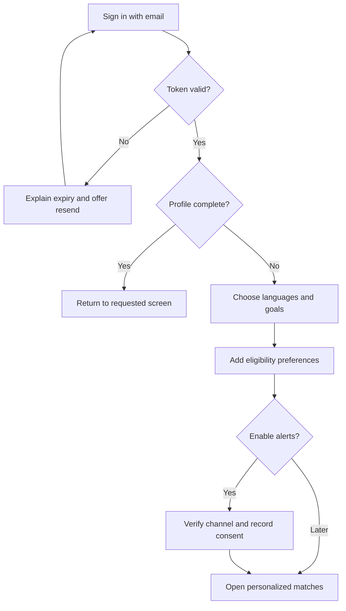
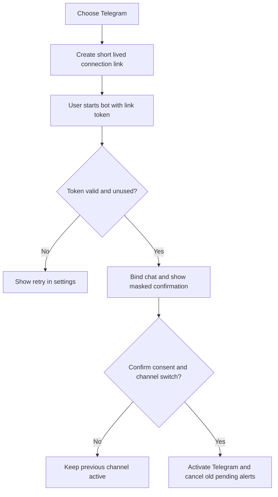
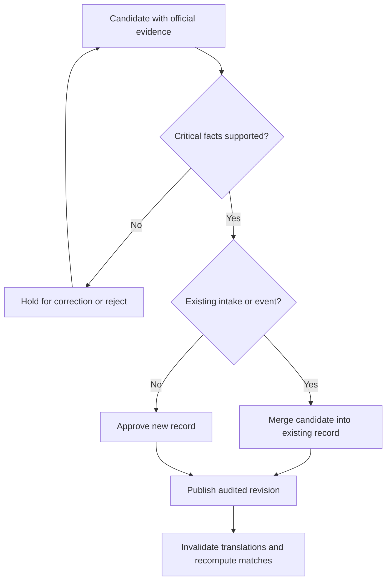

# smartmanuAI Screen Flows

Version 0.1 | 29 October 2026 | Design proposal

Based on [Product requirements](smartmanuAI_PRD_v0_1.md). This document specifies behavior and navigation for the MVP, not finished visual designs. Routes are proposed contracts. The PRD remains authoritative; open scope and language decisions remain open.

## 1 Navigation and screen inventory

Public navigation: Opportunities, language selector and Sign in. Signed-in navigation: Matches, Saved and Settings. Admin navigation is visible only to authorized administrators. Navigation visibility does not replace server authorization.

| ID | Route | Audience | Main content and action |
| --- | --- | --- | --- |
| S01 | /opportunities | Public | Search, filters, result count, freshness and opportunity cards; open details |
| S02 | /opportunities/:id | Public | Official source, funding components, remaining costs, deadline precision, eligibility and verification time; save or visit application |
| S03 | /sign-in | Public | Email entry and verification instructions; preserve intended internal destination |
| S04 | /auth/verify | Public | Validate single-use sign-in token; continue to onboarding or intended destination |
| S05 | /onboarding | Verified user | Language, goals, profile and alert setup; save progress and continue |
| S06 | /matches | User | Personalized results with match reasons and eligibility unknowns; edit preferences |
| S07 | /saved | User | Interested, applying and applied records; unsave or change status |
| S08 | /settings/profile | User | Nationality, residence, qualification, study levels, topics, funding and participation preferences |
| S09 | /settings/languages | User | Separate interface, alert and acceptable teaching languages |
| S10 | /settings/notifications | User | Channel connection, digest frequency, timezone, reminders and pause controls |
| S11 | /settings/account | User | Sessions, data deletion and account controls |
| S12 | /notifications/unsubscribe | Token holder | Confirm or display email opt-out; no sign-in required |
| A01 | /admin/review | Admin | Candidates, source evidence and conflicting fields; approve or reject |
| A02 | /admin/opportunities/:id | Admin | Revision editor, audit history, merge duplicates, close or archive |
| A03 | /admin/sources | Admin | Official URLs, check policy, last success, failures and pause controls |
| A04 | /admin/operations | Admin | Job failures, queue age, delivery states, cost usage and budget controls |

Not-found screens never expose unpublished records or private user data. Unpublished opportunities return not found to public visitors. Known closed or stale published opportunities retain a clearly labelled detail page for saved links; application reminders are suppressed.

## 2 Browse and save

1. Visitor opens S01. Filters appear in the URL so reload, back navigation and sharing preserve the public search.
2. Each card shows category, organizer, mode, funding label, deadline status and last checked time. “Tuition only” and “travel not covered” remain visible.
3. S02 explains the funding components and eligibility. Show “Not stated” for missing source facts and “Needs checking” for uncertain personal eligibility.
4. Visiting the official application is available without registration. Opening it does not mark the user as applied.
5. Saving while signed out opens S03 with a validated internal return destination. After authentication and any incomplete onboarding, return to S02 and ask the user to complete the save action.
6. A signed-in save creates one saved item, defaults to interested and confirms success. Repeated clicks do not duplicate it.

Closed opportunities can remain in Saved with their status; do not silently remove user history. Dismissal affects personalized discovery, not the underlying catalogue. Material changes can resurface a dismissed item with an explicit “Updated since you dismissed it” label.

## 3 Registration and onboarding

S03 uses the same generic response whether an email already exists. Rate-limit sends and resends. Verification tokens are short-lived and single-use. Preserve completed onboarding steps after reload; a failed save keeps form values and identifies the failing step.

Proposed onboarding steps:

| Step | Inputs | Validation and outcome |
| --- | --- | --- |
| Language and goals | Supported interface locale, alert locale, opportunity types and topic interests | Only supported locales can be selected; language preferences are separate |
| Profile | Nationality, residence, highest qualification, target levels and teaching languages | Offer “Prefer not to say” for eligibility details; missing facts remain unknown |
| Preferences | Funding, online or in-person, timezone | Explain that free participation can exclude travel; validate timezone |
| Alerts | Email or Telegram, daily or weekly, reminders and material updates | Optional opt-in; a user can finish with alerts disabled |

Collect optional age or language test details later when relevant. Never request passport, bank or application document uploads in these flows.

## 4 Matches and tracker

S06 defaults to known compatible or uncertain matches, excluding known disqualifications. Show a concise reason such as “Robotics topic and master's level match” with separate unknowns. Do not show admission probabilities. A deliberate “Browse outside my profile” action leads to public filters and displays mismatches.

S07 has status filters rather than requiring drag and drop. Users can change interested to applying or applied and back. “Applied” is self-reported. Saving and application status changes are separate actions. Default reminders cover saved interested and applying records; applied records can retain reminders only if the user explicitly opts in.

States for all result screens: loading, loaded, empty, recoverable error and offline. Empty matches show last successful catalogue refresh and links to edit filters. Errors keep the previous successful view where available, labelled with its fetch time. Never substitute unrelated opportunities.

## 5 Language behavior

Changing interface language updates navigation and controls. Changing alert language updates future messages. Changing teaching languages recalculates matches. These actions must not overwrite one another.

Show the selected language, original source language and a disclosed fallback if translated content is unavailable. Preserve official program and institution names; translated summaries link to original evidence. Unsupported locale URLs resolve to the supported fallback with an explanation. Native date formatting never hides an unknown source timezone.

## 6 Notification connection and control

Email: verified account email is the initial destination. Explicit consent enables digests; verification alone does not. Changing email requires verification of the new address before activation.

The account that issued the link owns the binding; the Telegram callback must never accept an arbitrary browser-supplied user ID. Tokens expire after a proposed 10 minutes and are stored hashed. Do not show connection tokens in analytics or logs. Only one active channel is permitted in the MVP. An incomplete switch keeps the old channel until the new destination is verified and consented.

S10 shows connected, pending, paused, disconnected and failed states. Users can preview a digest without sending it. Disconnecting Telegram disables delivery and invalidates pending connection tokens. A blocked bot shows reconnect guidance without silently enabling email.

S12 displays the email opt-out result without requiring account access. A GET landing must not accidentally opt out through a mail scanner; use a confirmation POST, with a provider-compatible one-click POST path where supported. A successful opt-out is idempotent and cancels queued email alerts. Provide a sign-in link to manage other account settings.

## 7 Account deletion

S11 explains what will be deleted and the PRD's proposed deletion period. Require recent authentication and explicit confirmation. Immediately pause alerts, cancel pending deliveries and revoke sessions after a request is accepted. Show confirmation before ending the session. An interruption must not leave notifications enabled after a committed deletion request. Backups expire according to the documented launch policy.

## 8 Admin review and operation

A01 places source evidence beside the extracted field, including retrieval time and conflicts. Funding and deadline overrides require a reason and supporting evidence. A failed fetch cannot be used as evidence that applications closed. An administrator can manually author a record using the same evidence checks.

A02 previews the user-facing record before publication. Duplicate merge chooses a surviving identity, retains source URLs and maps saved items without losing user tracker status. If saved statuses conflict, preserve an audit trail and prefer the user's most recently updated status.

A03 can pause or resume a source with an audit reason. A04 distinguishes provider accepted from read, allows bounded job retry and exposes spend controls. A retry must not imply resend of an already accepted message.

## 9 Screen acceptance and requirement coverage

| PRD requirement | Screens and observable acceptance |
| --- | --- |
| FR01 | S03–S05, S08, S11: verified access, editable profile and isolated records |
| FR02 | S01, S06: all PRD filters work and persist through navigation |
| FR03 | S02: funding, official evidence, deadline uncertainty and freshness are visible |
| FR04 | S06: exclusions, explanations and unknown eligibility are distinguishable |
| FR05 | S02, S07: save, dismiss and tracker actions survive reload |
| FR06 | S05, S09: all three language preferences act independently |
| FR07 | S10: consent, timezone and daily or weekly choice control delivery |
| FR08 | A01–A04: role checks, evidence review and audited changes |
| FR09 | S10–S12: pause, unlink, opt-out and deletion work without support |

Validate every flow on narrow mobile and desktop layouts, with keyboard-only use, labelled fields, visible focus, inline errors and announced success messages. Include signed-out return, expired verification, empty catalogue, unknown funding, stale data, interrupted Telegram connection, failed delivery and deletion scenarios in the implementation acceptance suite.

## 10 Decisions carried forward

Launch locales, worldwide online event scope, minimum account age, budget and provider selection remain open as stated in the PRD. Screen labels here are proposed English copy. The next design step is visual wireframes against these flows after implementation prerequisites in [Delivery workflow](delivery-workflow.md) are resolved.
