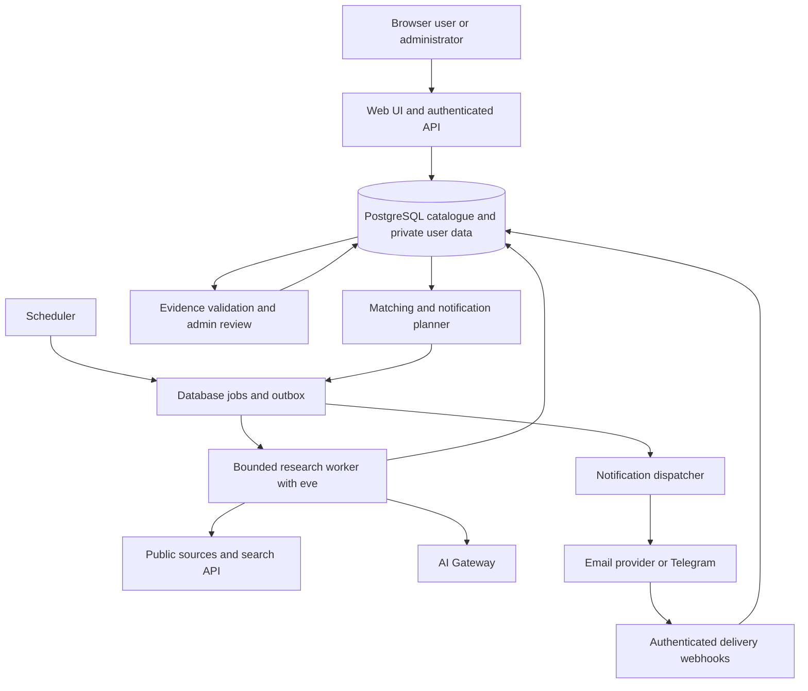

# smartmanuAI Technical Architecture

Version 0.1 | 29 October 2026 | Proposed implementation architecture

References: [PRD](smartmanuAI_PRD_v0_1.md), [Screen flows](screen-flows.md), [Delivery workflow](delivery-workflow.md).

## 1 Architecture decision

Build one shared research pipeline and catalogue for all users. Use deterministic application services for authentication, eligibility, consent and delivery; use AI for bounded extraction, topic classification and translation. No autonomous agent may publish opportunities or send user notifications directly.

Proposed stack: TypeScript on Node.js 24 or newer, a Next.js web frontend and application API, an eve research runtime, PostgreSQL for application data and a database-backed job/outbox queue. Use Vercel AI Gateway model identifiers with a cost-capped model configuration. These are design choices, not installed dependencies or a deployment claim.

The eve documentation describes Node deployment and Vercel deployment options. Production workflow storage must match the chosen host; local workflow data on ephemeral disk is unacceptable. Pin the framework version and verify restart and upgrade behavior before selecting hosting. The database application queue and eve runtime checkpoints serve separate purposes and are not interchangeable.

Hosting, authentication provider, PostgreSQL provider, search API, email provider and model remain open. A provider feasibility check must cover persistence, delivery limits, regional access, backup costs and the proposed US$30 monthly ceiling. Do not assume another project's database or credentials are available.

## 2 Logical components and trust boundaries

The diagram shows logical responsibilities, not a requirement for one paid service per box. A pilot can share a repository and deployment where supported. Research and delivery workers must not execute inside a browser request. Public pages never access job payloads, tokens, raw private profiles or admin audit details.

## 3 Repository structure

Proposed locations after the implementation scaffold is validated:

| Location | Responsibility |
| --- | --- |
| docs/ | PRD, screen flows, architecture, workflow and decision history |
| apps/web/ | Pages, authenticated application handlers and public catalogue reads |
| agent/ | eve configuration, instructions and narrowly scoped research tools |
| src/domain/ | Funding, deadlines, eligibility, revisions and match rules |
| src/services/ | Collection, validation, translation, matching and consent |
| src/jobs/ | Job claiming, orchestration, digest planning and delivery |
| src/adapters/ | Search, retrieval, model, email, Telegram and identity integrations |
| db/ | Versioned migrations, indexes and synthetic development seeds |
| tests/ | Domain cases, authorization integration tests and end-to-end flows |

This is a proposed application layout, not an exact eve scaffold contract. Read the pinned package's bundled documentation before placing runtime files or choosing build scripts. Do not initialize a nested Git repository.

## 4 Core data model and constraints

Use UUID identifiers and UTC timestamps, with explicit source date precision and user timezone fields. Preserve original deadline text and the source timezone when known. Never convert a date-only unknown-zone deadline into a claimed exact instant.

| Table group | Important fields and constraints |
| --- | --- |
| users and profiles | Identity subject unique; profile belongs to user; locale, qualification, nationality and preferences |
| notification_preferences | One row per user; one active channel; consent version, timezone, frequency, next digest slot, reminder and update settings |
| channel_bindings | Owner, type, encrypted destination, verified time, revoked time; no tokens in public responses |
| connection_tokens | Hashed single-use token, owner, expiry and consumed time; consume atomically |
| sources and source_fetches | Canonical official URL, policy, next due time, retrieval hash, last success, status and failure history |
| opportunities | Stable identity, organizer, intake or event identity, category, publication state and current revision |
| opportunity_revisions and evidence | Immutable revision number, field values, funding components, eligibility predicates, evidence excerpts and URLs |
| opportunity_sources | Source aliases and candidate-to-survivor mapping for duplicate merges |
| translations | Unique revision, locale and translation version; pending, ready or failed state |
| saved_items | Unique user and opportunity; status, dismissed flag and user update time |
| match_results | Unique user, opportunity, profile version, rules version and opportunity revision; explanation and unknowns |
| jobs | Unique semantic job key, state, attempts, next attempt, lease owner and expiry |
| notification_intents and deliveries | Event key, user, revision, reminder threshold, schedule slot, channel and binding version; unique deduplication keys |
| budget_ledger | Period, provider, reserved estimate, settled amount, usage and reconciliation state |
| audit_events and deletion_requests | Actor, action, reason, timestamps and references; avoid unnecessary personal data |

The account identity provider owns sign-in credentials. Application authorization still verifies ownership on every private operation. Use database policies or narrowly scoped database roles as defense in depth; public catalogue reads select only published public fields.

## 5 Application and webhook contracts

These endpoints are proposed application contracts, not third-party SDK APIs.

| Endpoint | Access and behavior |
| --- | --- |
| GET /api/opportunities and /api/opportunities/:id | Public, paginated and rate-limited; published records only |
| GET or PATCH /api/me/profile | Authenticated owner; validate input and increment profile version |
| GET /api/me/matches | Authenticated owner; version-aware matching with unknowns |
| GET or PUT or DELETE /api/me/saved/:id | Authenticated owner; idempotent tracker updates |
| PATCH /api/me/notifications | Authenticated owner; versioned consent and atomic channel switch |
| POST /api/me/telegram/connect | Authenticated owner; issue expiring single-use token |
| POST /api/webhooks/telegram | Validate webhook secret; deduplicate update ID; atomically bind token or process block status |
| POST /api/webhooks/email | Verify provider signature and event ID; suppress bounced or complained destinations |
| POST /api/notifications/unsubscribe | Scoped signed token; idempotent suppression without a session |
| POST /api/me/deletion | Recent authentication; pause and revoke immediately, enqueue purge |
| POST /api/admin/opportunities/:id/revisions | Admin only; expected revision, evidence validation and audit |
| POST /api/admin/jobs/:id/retry | Admin only; bounded retry with existing event identity |

The identity adapter defines sign-in callback and token lifecycle after provider selection. Cookie-authenticated writes require CSRF protection. Validate internal return paths to prevent open redirects. Admin actions reject stale revision numbers instead of overwriting concurrent edits. Error responses use stable error codes and safe messages.

## 6 Research and publication workflow

1. Scheduler creates one due discovery or source-check job with a semantic deduplication key.
2. Worker reserves estimated paid usage, claims a lease and applies source-specific rate limits.
3. Search results produce candidates; a candidate must resolve to an official supporting source.
4. Retriever validates URL, DNS target and every redirect; block private, link-local and loopback networks, oversized responses and unsafe schemes. Limit time, bytes, redirects and supported content types.
5. Hash normalized content. Unchanged facts skip AI extraction and refresh the successful check time.
6. Changed content enters bounded structured extraction. Require evidence for funding and deadlines; unknown fields remain null with a reason.
7. Application code validates schema, topic scope, evidence and candidate identity. Conflicts go to review.
8. During the pilot an administrator approves every publication. A revision and audit event commit together; an outbox event requests translation and rematching.
9. Publish only eligible records. New or material revisions invalidate old translations; changes to title spelling alone do not create a new alert event.

Proposed AI caps: 12,000 input tokens, 2,000 output tokens, three tool steps and one repair attempt per extraction. These are configuration defaults to benchmark, not guarantees of model quality. Reject outputs that fail schema validation after the repair. Do not give extraction tools notification credentials, shell access or unrestricted database tools. Browser automation is disabled initially and requires a source-specific feasibility decision.

Freshness defaults follow the PRD: daily discovery, weekly open-record checks and daily checks within 14 days of closing. First alerts require a successful check within 24 hours. After seven days without a successful required check, mark stale and suppress new alerts. Network failure does not prove closure. For a date-only deadline, display the date and uncertainty; suppress reminders from the start of that calendar date in the known source zone, or UTC if the zone is unknown, as a conservative internal rule rather than a claimed closing time. Unknown or rolling deadlines do not get invented countdowns.

## 7 Matching and translations

Represent eligibility predicates as pass, fail or unknown. Known hard failures exclude a record from default matches; unknowns are explicitly reported. Ranking uses topic overlap, target level, funding preferences and deadline proximity. Keep ranking rules versioned and explainable. Do not infer admission probability.

Profile changes invalidate that user's match cache; record revisions invalidate affected opportunity matches. Batch rule evaluation across users and avoid AI calls per user. Cache translations by revision and locale, preserve institution names and source links, and disclose English fallback where a selected supported translation is pending. Launch languages remain an open product decision.

## 8 Scheduling and delivery semantics

Calculate digest slots in each user's IANA timezone, then persist the corresponding UTC instant. Proposed daily slot is 09:00; proposed weekly slot is Monday 09:00. A repeated local hour creates one slot, and a skipped local time moves to the next valid local instant. Empty digests are suppressed.

Record unseen eligible event identities independently of channel. A digest contains at most 10 items; overflow remains unseen for subsequent slots and is also available in the feed. Do not mark omitted items notified. Initial activation considers currently open matching records and uses the same cap.

A semantic event key includes user, opportunity, meaningful revision and event type; reminders also include the 7-day or 2-day threshold and deadline revision. A delivery key additionally includes channel binding version and digest schedule slot where applicable. Changing channels cancels pending old-channel deliveries without replaying already notified events.

Before each send, reload consent, current binding, deletion status, publication state, deadline and freshness. Reverify before deadline reminders. Known disqualification suppresses personalized delivery. Material deadline or funding changes can send an opted-in saved-item update even if the new facts make the item ineligible; clearly explain the change. Normal discovery funding rules must not hide a withdrawal update from affected users.

Use a transactional outbox, atomic job claims, expiring leases and bounded retries. Proposed transient retries are 1 minute, 5 minutes and 30 minutes, respecting provider retry instructions; permanently failed jobs enter manual review. A crash after provider acceptance but before recording success creates an ambiguous delivery. Use provider idempotency when available; otherwise retain an uncertain state and do not blindly resend. The application can prevent duplicate enqueueing but cannot promise exactly-once delivery through every provider.

Email signatures, Telegram webhook secrets and duplicate callback IDs are mandatory. Bounces, complaints and bot blocks suppress delivery. Provider-accepted does not mean read. Auth and account-service messages are separated from optional opportunity digests.

## 9 Persistence and deployment

The production runtime must use durable workflow storage and a production authentication policy. If hosted on an ephemeral filesystem, do not rely on eve's default local on-disk world. Evaluate a supported persistent workflow backend or a managed workflow deployment, including version compatibility and migration tests.

Use separate development, staging and production secrets and data. Staging uses synthetic profiles and a notification sink; never point it at live subscriber destinations. Deploy a web service and bounded background execution only after cost and persistence checks pass. No Redis, vector database or Kubernetes is required by this design.

Apply backward-compatible migrations first; drain or pause incompatible jobs during worker upgrades. Pin eve exactly, test recovery after restart and plan session compatibility on upgrades. Database business records and the outbox remain the authoritative recovery source for research batches. Back up production data and verify a restore before public release.

## 10 Cost and operations

Use the PRD pilot assumptions rather than unverified provider free tiers. The US$30 monthly amount is an unapproved target, not a forecast. Quote all fixed costs and add estimated search, model, email, backup and tax costs before enabling paid execution.

Atomically reserve worst-case paid usage before dispatch so concurrent jobs cannot exceed the variable budget. Reconcile actual usage afterward; failed calls may still incur charges. Alert at 70 percent, reduce optional discovery at 90 percent and stop nonessential paid research at the ceiling. Reserve account operations, consent processing and already verified delivery capacity separately. Reconcile provider invoices; local usage estimates do not constitute a provider-enforced billing cap.

Observe job success rate, last source check, review backlog, stale catalogue count, queue age, suppression rate, uncertain deliveries, bounce rate, model token usage and cost per published record. Admin alerts trigger after two consecutive scheduled-run failures. Record request IDs and safe error codes without tokens, source instructions or private profiles in logs.

Targets remain the PRD's proposals: feed p95 below two seconds under an agreed pilot load and 99 percent successful scheduled runs per rolling month. Retention defaults are delivery logs 90 days and evidence revisions 180 days; define backup expiry and deletion handling before launch.

## 11 Validation and traceability

| PRD requirement | Architecture control | Required validation |
| --- | --- | --- |
| FR01 | Identity adapter, owner checks and scoped data access | Two-account access isolation and deletion |
| FR02 | Indexed public queries and pagination | Filter combinations and pagination consistency |
| FR03 | Immutable evidence, funding components and date precision | Funding and deadline truth fixtures |
| FR04 | Three-valued eligibility and versioned matching | Known failure versus unknown field cases |
| FR05 | Unique saved items and independent tracker status | Reload, repeat action and merge preservation |
| FR06 | Independent language fields and revision-keyed translations | Locale fallback and teaching-language rematch |
| FR07 | Outbox, timezone slots and consent checks | Digest, daylight saving, retry and overflow |
| FR08 | Admin roles, expected revisions and audit writes | Forbidden admin requests and concurrent edits |
| FR09 | Scoped opt-out, binding revocation and purge job | Queued-message suppression and unlink |

Additional failure exercises: retrieval to a private network, prompt injection in source text, poisoned funding extraction, source timeout, workflow restart, provider timeout after acceptance, concurrent budget reservations and restoration from backup. Evaluate at least 50 reviewed records, or the full smaller catalogue, against PRD quality gates before public release.

## 12 Decisions and implementation gates

The TypeScript, PostgreSQL, Next.js and eve direction is a proposal to validate in a scaffold spike. The spike must demonstrate authenticated access, one bounded extraction, durable restart and a sandboxed notification, with a priced operating plan. Launch languages, event scope, account age and business model remain unresolved. Record accepted changes as dated decisions rather than silently revising the PRD.

Official framework references checked on 29 October 2026:

- [eve getting started](https://eve.dev/docs/getting-started) — runtime prerequisites and project setup.
- [eve deployment overview](https://eve.dev/docs/guides/deployment/overview) — host choices and production route policy.
- [eve execution model and durability](https://eve.dev/docs/concepts/execution-model-and-durability) — storage and upgrade behavior.
- [eve schedules](https://eve.dev/docs/schedules) — reference for implementation scheduling integration.

Read documentation bundled with the pinned package before using framework APIs. This document does not claim that application adapters, infrastructure or automated searches exist yet.
